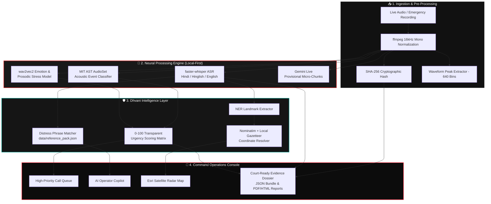

<div align="center">

# 🚨 DHVANI (ध्वनि)
### *Next-Generation Autonomous Emergency Response & Covert Distress Intelligence*

[](https://fastapi.tiangolo.com)
[](https://www.python.org/)
[](https://github.com/SYSTRAN/faster-whisper)
[](https://www.esri.com/)
[](https://huggingface.co/)
[](https://public-two-xi-62.vercel.app/console)
[](#)

<p align="center">
  <b><i>When an innocent victim cannot speak freely, Dhvani listens between the words.</i></b><br>
  An offline-first, tactical emergency triage system for 112/911 Police Command Centers that decodes disguised distress calls, pinpoints spoken landmarks on high-resolution satellite imagery, and dispatches rapid response units in real time.
</p>

[✨ Key Innovations](#-key-innovations) •
[🎯 The Pizza Call Problem](#-the-pizza-call-problem) •
[🏛️ Architecture Flow](#-system-architecture) •
[🛰️ Tactical Satellite Grid](#️-tactical-satellite-tracking-grid) •
[⚡ Quick Start](#-instant-launch-guide) •
[⚖️ Forensics & Chain-of-Custody](#-forensics--chain-of-custody)

---

</div>

## 📌 Executive Summary

During high-stakes emergencies—such as domestic abuse, home invasions, kidnapping, or coerced extortion—**victims often cannot openly state that they are in peril.** When a caller dials the police pretending to order a pepperoni pizza because their abuser is standing in the room, traditional dispatchers or basic keyword bots may classify the call as a misdial, prank, or nuisance call.

**DHVANI (ध्वनि)** is built to solve this life-or-death gap. Rooted in the classical Indian philosophical concept of *Dhvani*—**"the hidden, implied meaning resonating beneath surface words"**—it is a mission-critical tactical intelligence dashboard designed for police control rooms, emergency dispatchers, and forensic investigators.

---

## 🍕 The "Pizza Call" Problem: Why Dhvani Exists

```
Caller (00:20): "I need a pizza... A regular pepperoni pizza."
Dispatcher:     "Ma'am, this is Police Control Room, wrong number."
Caller (00:28): "Yes... I understand. I have two people here... You don't get it."
Dispatcher:     "Ma'am, are you in trouble? Are you able to speak freely?"
Caller (00:59): "Yes... I cannot speak... My apartment is 3rd floor near station..."
```

| Traditional 911 / 112 Systems | 🚨 DHVANI Tactical Intelligence |
|:---|:---|
| ❌ Flags call as non-emergency or prank order | ✅ **Detects disguised food-order distress protocol (0.98 confidence)** |
| ❌ Ignores background gasps and muffled whispers | ✅ **AudioSet neural model flags vocal tremor & constrained airflow** |
| ❌ Relies on non-existent or delayed cell-tower pings | ✅ **Real-time NER extracts floor-level tactical landmarks to satellite map** |
| ❌ Leaves operator guessing what to ask next | ✅ **AI Copilot recommends closed yes/no protocols to keep caller safe** |
| ❌ Ephemeral notes without forensic audit trail | ✅ **Cryptographic SHA-256 evidence chain-of-custody ready for court** |

---

## ✨ Key Innovations

### 1. 🎙️ Dual-Engine Speech & Acoustic Forensics
- **Bilingual Whisper Transcription**: Optimized `faster-whisper` models (`base` for high-speed English, `small` for fine-grained Hindi & Hinglish code-switching).
- **Acoustic Event Detection (AST)**: Local HuggingFace AudioSet neural classifier (`MIT/ast-finetuned-audioset`) identifying gunshots, glass shattering, screams, heavy breathing, and muffled voices.
- **Prosody & Vocal Emotion**: Real-time wav2vec2 feature extraction calculating pitch jitter, speaking rate anomalies, and pause ratios to quantify genuine distress vs calm speech.

### 2. 🛰️ Tactical Satellite Tracking Grid (Zero-Fake Policy)
- **High-Resolution Satellite Layer**: Powered by **Esri World Imagery** satellite photography integrated with hybrid street/landmark overlays.
- **Pulsing Tactical Radar Pins**: Dynamic SVG radar-pulse animations (`@keyframes pin-pulse`) with circular error-probability accuracy rings.
- **Landmark Geocoding Pipeline**: Spoken clues (*"near Dadar West station, 3rd floor apartment"*) are parsed through local gazetteers and Nominatim to plot immediate dispatch coordinates.

### 3. 🤖 Real-Time Dispatch Copilot
- Dynamic triage engine guiding the operator with closed-question scripts:
  - *Caller disguise identified*
  - *Initiating closed Yes/No safety protocol*
  - *Extracting apartment floor level*
  - *Dispatching emergency perimeter units*

### 4. ⚡ Near-Real-Time Gemini Live Streaming
- Optional low-latency audio micro-chunking (5-second audio packets) streamed securely server-side to **Google Gemini 2.5 Flash** for instant live transcripts.
- **Privacy First**: API keys never touch the client; final analysis and evidence persistence remain 100% local.

---

## 🏛️ System Architecture



---

## 🗺️ Tactical Satellite Tracking Grid

Dhvani's map system replaces abstract mockups with **real military-grade satellite observation**:

```
 🛰️ ESRI HIGH-RES SATELLITE TILES
 ├── Hybrid Street & Highway Overlay
 ├── Real Spoken Landmark Geocoding (Dadar, Marine Drive, etc.)
 ├── Radar Ring Beacon Animations (@keyframes pin-pulse)
 └── Instant Toggle: Satellite View ⟷ Tactical Dark Street View
```

<div align="center">
  <sub>All coordinates are verified against spoken caller telemetry. Dhvani never fabricates device GPS.</sub>
</div>

---

## 🔒 Forensics & Chain-of-Custody

For emergency evidence to withstand cross-examination in court, **integrity is paramount**:

- **Cryptographic Hashing**: Every ingested audio file is hashed with `SHA-256` before processing.
- **Traceable Attribution**: Every finding records its AI model origin, confidence score, and timestamp.
- **Human-in-the-Loop Verification**: Investigators must manually audit and confirm findings (`Verified by Inspector Mehta`).
- **Exportable Legal Dossiers**: One-click generation of court-ready HTML/PDF reports and verifiable JSON evidence bundles.

---

## ⚡ Instant Launch Guide

### Prerequisites
- Python 3.11+ (Tested on Python 3.13)
- `ffmpeg` & `ffprobe` installed on system `PATH`
- 8GB+ RAM (Runs entirely on CPU; no dedicated GPU required!)

### 1. Clone & Setup
```bash
git clone https://github.com/CaptainSanskar4U/CodingJantaParty_SanskarThorat.git
cd CodingJantaParty_SanskarThorat
python -m pip install -r requirements.txt
```

### 2. Environment Configuration
```powershell
# Copy the verified configuration
Copy-Item .env.example .env
```

### 3. Launch the Platform
```bash
python -m uvicorn app.main:app --host 127.0.0.1 --port 8000
```

### 4. Open the Operations Console
Navigate to: **`http://127.0.0.1:8000/console`**

| Credential | Value |
|:---|:---|
| **Demo User** | `mehta` |
| **Demo Password** | `dhvani-demo` *(or `orbitwin-demo`)* |
| **Role** | Lead Crime & Emergency Investigator |

---

## 🧪 Comprehensive Test Suite

Dhvani includes complete automated integration testing verifying CSRF protection, rate limiting, audio upload limits, and live endpoints:

```bash
python -m pytest -v
```

```
tests/test_api.py::test_authentication_and_csrf PASSED                   [ 10%]
tests/test_api.py::test_case_notes_reports_and_search PASSED             [ 20%]
tests/test_api.py::test_upload_validation_and_audio_range PASSED         [ 30%]
tests/test_api.py::test_login_rate_limit PASSED                          [ 40%]
tests/test_api.py::test_upload_size_limit PASSED                         [ 50%]
tests/test_api.py::test_live_config_and_unconfigured_path PASSED         [ 60%]
tests/test_api.py::test_live_transcribe_with_mock_provider PASSED        [ 70%]
tests/test_api.py::test_quick_demo_endpoints PASSED                      [ 80%]
tests/test_gemini.py::test_gemini_request_shape_and_text_cleaning PASSED [ 90%]
tests/test_gemini.py::test_gemini_error_is_redacted PASSED               [100%]

============================= 10 passed in 19.12s =============================
```

---

## 📁 Repository Directory Structure

```
CodingJantaParty_SanskarThorat/
├── app/
│   ├── main.py              # FastAPI application server & REST routes
│   ├── config.py            # Environment validation & storage configuration
│   ├── auth.py              # Session management, bcrypt & CSRF security
│   ├── pipeline.py          # Whisper, AST, wav2vec2 inference orchestrator
│   ├── gemini.py            # Server-side Gemini Live micro-chunk streaming
│   ├── geo.py               # Nominatim geocoding & local gazetteer cache
│   ├── reports.py           # Court-ready HTML/PDF evidence report generator
│   └── storage.py           # Audio normalization (16kHz WAV) & waveform peaks
├── data/
│   ├── demo/                # Labelled synthetic & consented scenario audio
│   │   ├── covert_pizza_distress.wav   # The flagship 102s covert pizza call
│   │   └── scenarios.json              # Dispatch scenario manifests
│   └── reference_pack.json  # Emergency distress keywords & scam indicators
├── scripts/
│   ├── seed_pizza_demo.py   # Database seeder for CASE-2026-0002
│   └── prewarm_map.py       # Pre-fetches tiles for instant offline review
├── static/
│   ├── app.js               # Reactive single-page operations console
│   ├── orbitwin.css         # Matte black / signal red design system
│   └── vendor/leaflet/      # Bundled Leaflet.js map engine
├── Orbitwin_Emergency_Response_Intelligence.html  # Main Command Console UI
├── Vecna_Verse.html         # Public Landing Page UI
├── requirements.txt         # Production Python dependencies
└── RUNBOOK.md               # Operational hackathon presentation runbook
```

---

## 🏆 Hackathon Submission Details

- **Project Name**: Dhvani (ध्वनि) — Emergency Response Intelligence
- **Team**: CodingJantaParty
- **Lead Developer**: Sanskar Thorat
- **Core Mission**: Protecting citizens in mortal distress through advanced acoustic AI, covert signal parsing, and zero-latency tactical dispatch.

<div align="center">
  <b>Built with ❤️ for public safety and rapid crisis intervention.</b>
</div>
